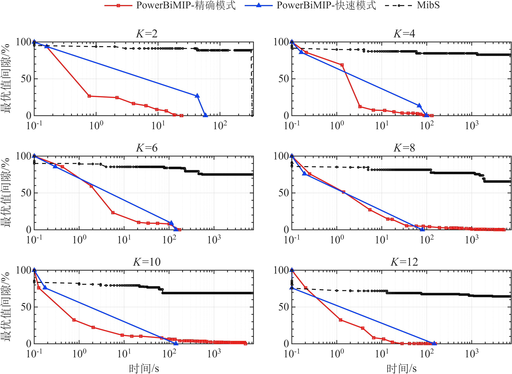
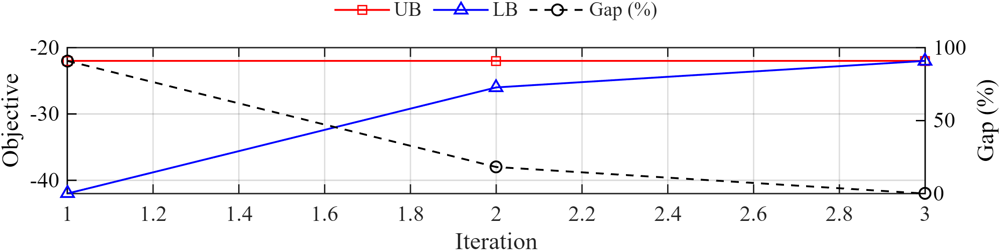
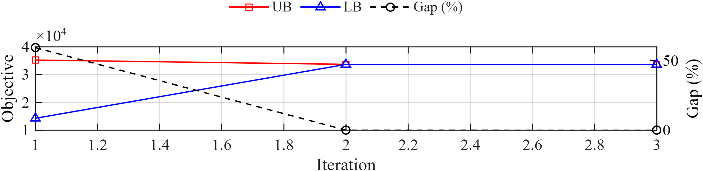

<div align="center">
  <picture>
    <source media="(prefers-color-scheme: dark)" srcset="docs/source/_static/PowerBiMIP_logo-dark.svg">
    <source media="(prefers-color-scheme: light)" srcset="docs/source/_static/PowerBiMIP_logo.svg">
    
  </picture>
</div>

<h1 align="center">PowerBiMIP: A Dedicated Bilevel Mixed-Integer Programming Solver, Tailored to Power and Energy Systems</h1>

<p align="center">
  <strong>English</strong> | <a href="README_CN.md" lang="zh-CN">简体中文</a>
  &nbsp;·&nbsp;
  <a href="https://docs.powerbimip.com">Documentation</a>
  &nbsp;·&nbsp;
  <a href="https://docs.powerbimip.com/en/latest/case_library.html">Case Library</a>
  &nbsp;·&nbsp;
  <a href="https://doi.org/10.13334/j.0258-8013.pcsee.261230">Paper</a>
</p>

<p align="center">
  <a href="https://docs.powerbimip.com"></a>
  <a href="matlab/VERSION"></a>
  <a href="#installation"></a>
  <a href="LICENSE"></a>
  <a href="https://doi.org/10.13334/j.0258-8013.pcsee.261230"></a>
</p>

**PowerBiMIP** is a dedicated MATLAB solver (built on YALMIP) for linear bilevel mixed-integer programming (BiMIP) and two-stage robust optimization with linear programming recourse (TRO-LP), tailored specifically to power and energy systems. Its bilevel solver handles continuous, binary, and integer variables at both levels under optimistic and pessimistic formulations.

> [!NOTE]
> **Python and Pyomo support (in development):** PowerBiMIP v0.1.5 runs in MATLAB. A Python implementation with Pyomo modeling support is under active development.

---

## Overview and capabilities

- **Mixed-integer variables at both levels:** Declare continuous (`sdpvar`), binary (`binvar`), and integer (`intvar`) variables in both upper and lower problems. Objectives and constraints must be linear.
- **Optimistic and pessimistic formulations:** Solve optimistic bilevel models with or without upper-level coupling constraints (reformulated automatically when needed), and uncoupled pessimistic bilevel models via regularized reformulation and post-solve optimality verification. Pessimistic mode currently requires exact methods and uncoupled upper-level constraints.
- **Exact R&D and fast penalty methods:** Choose reformulation-and-decomposition (R&D) with KKT (`exact_KKT`) or strong-duality (`exact_strong_duality`) master problems, binary interdiction C&CG cuts, or an L1-penalty alternating direction method (`quick`) for large optimistic BiMIP and robust instances.
- **Two-stage robust optimization and MPS/AUX I/O:** Solve two-stage robust models via column-and-constraint generation (`solve_TRO`, currently supporting LP recourse), and import or export MibS `.mps`/`.aux` files (`mpsaux2yalmip`, `exportBiMIPToMibS`).

### Comparison with existing toolboxes

<table>
  <thead>
    <tr>
      <th rowspan="2" scope="col" align="left">Toolbox</th>
      <th rowspan="2" scope="col" align="center">Programming platform</th>
      <th colspan="3" scope="colgroup" align="center">Model support</th>
    </tr>
    <tr>
      <th scope="col" align="center">Lower-level<br>integer vars.</th>
      <th scope="col" align="center">OBL</th>
      <th scope="col" align="center">PBL</th>
    </tr>
  </thead>
  <tbody>
    <tr>
      <td>YALMIP</td>
      <td align="center">MATLAB</td>
      <td align="center"></td>
      <td align="center"><strong>✓</strong></td>
      <td align="center"></td>
    </tr>
    <tr>
      <td>Pyomo/PAO</td>
      <td align="center">Python</td>
      <td align="center"></td>
      <td align="center"><strong>✓</strong></td>
      <td align="center"></td>
    </tr>
    <tr>
      <td>BilevelJuMP</td>
      <td align="center">Julia</td>
      <td align="center"></td>
      <td align="center"><strong>✓</strong></td>
      <td align="center"></td>
    </tr>
    <tr>
      <td>GAMS/EMP</td>
      <td align="center">GAMS</td>
      <td align="center"></td>
      <td align="center"><strong>✓</strong></td>
      <td align="center"></td>
    </tr>
    <tr>
      <td>MibS</td>
      <td align="center">C++</td>
      <td align="center"><strong>✓</strong></td>
      <td align="center"><strong>✓</strong><sup>1</sup></td>
      <td align="center"></td>
    </tr>
    <tr>
      <td><strong>PowerBiMIP</strong></td>
      <td align="center"><strong>MATLAB (Python<sup>2</sup>)</strong></td>
      <td align="center"><strong>✓</strong></td>
      <td align="center"><strong>✓</strong></td>
      <td align="center"><strong>✓</strong></td>
    </tr>
  </tbody>
</table>

<sup>1</sup> MibS currently only supports cases where connecting variables are pure integer variables.<br>
<sup>2</sup> The Python version with Pyomo modeling support is under development; checkmarks describe the current MATLAB version.

### Benchmark against MibS on IEEE RTS-96

<div align="center">
  <a href="docs/source/_static/figures/powerbimip-mibs-time-to-gap.png">
    
  </a>
</div>

**Figure:** Optimality gap (<span lang="zh-CN">最优值间隙</span>, %, vertical axis) versus solve time in seconds on a logarithmic scale (<span lang="zh-CN">时间</span>, s, horizontal axis) on the one-area IEEE RTS-96 line-interdiction benchmark for attack budgets $K = 2, 4, 6, 8, 10, 12$. Red squares: PowerBiMIP exact mode (<span lang="zh-CN">PowerBiMIP-精确模式</span>); blue triangles: PowerBiMIP quick mode (<span lang="zh-CN">PowerBiMIP-快速模式</span>); black dashed line: MibS. Experimental setup and gap definitions are reported in our [paper](https://doi.org/10.13334/j.0258-8013.pcsee.261230).

---

## Installation

### Prerequisites

1. **MATLAB:** R2019b or newer.
2. **YALMIP:** Install a current version from the [YALMIP GitHub repository](https://github.com/yalmip/YALMIP). COPT users must verify the interface fix described below.
3. **A MILP solver:** Install at least one solver supported by YALMIP: Gurobi, CPLEX, COPT, or MOSEK.

#### Solver choice for academic users in China

According to [Gurobi's official notice](https://support.gurobi.com/hc/en-us/articles/33982552193937-As-a-student-at-a-university-in-China-how-do-I-request-a-Free-Academic-License), Gurobi has discontinued its free academic licensing program in mainland China, Hong Kong, and Macau (commercial licensing remains separate). We recommend [COPT](https://www.shanshu.ai/copt) for affected academic users.

#### Important: update YALMIP before using COPT

Affected YALMIP versions contain a bug in [`solvers/yalmip2copt.m`](https://github.com/yalmip/YALMIP/blob/develop/solvers/yalmip2copt.m): when the quadratic-objective matrix `Q` is nonzero but has at least one all-zero column (for example, when some variables enter the objective only linearly or conic reformulations add auxiliary variables), the interface can **silently drop the entire quadratic objective while still reporting a successful solve**. Purely linear MILPs are not affected by this check.

Update YALMIP to a revision containing the fix on the upstream `develop` branch, where `solvers/yalmip2copt.m` uses the scalar condition `nnz(interfacedata.Q)` instead of `any(interfacedata.Q)` at both quadratic-objective assignment and post-cone dimension extension. Updating COPT alone does not fix the YALMIP interface.

After updating, restart MATLAB and confirm that no older YALMIP copy shadows the updated file on your path:

```matlab
which yalmip2copt -all
```

### Setup steps

1. **Clone the repository** with Git or [GitHub Desktop](https://desktop.github.com/):
   ```bash
   git clone https://github.com/GreatTM/PowerBiMIP.git
   ```
2. **Add PowerBiMIP to the MATLAB path:** Open MATLAB, change to the `matlab/` directory, and run `install`:
   ```matlab
   cd PowerBiMIP/matlab
   install
   ```
   `install.m` adds `config/`, `examples/`, and `src/` to the MATLAB path, cleans up stale entries from older layouts, and saves the path.
3. **Verify the installation:** From `matlab/`, run the first toy example (change `'solver', 'gurobi'` in the script if you use `'cplex'`, `'copt'`, or `'mosek'`):
   ```matlab
   run('examples/BiMIP_benchmarks/BiMIP_toy_example1.m');
   ```
   A working setup converges in 3 iterations with `Objective value: -22.0000`, `Best bound: -22.0000`, and `Gap: 0.00%`.

### Updating

Run `git pull` from the repository root (or **Fetch origin** and **Pull origin** in GitHub Desktop). If an update moves or renames folders, run `install` once from `matlab/` and restart MATLAB.

---

## Quick start

Full tutorials and option tables for `BiMIPsettings` and `TROsettings` are available in the [Getting started documentation](https://docs.powerbimip.com/en/latest/getting_started.html).

### Example 1: bilevel mixed-integer programming (`solve_BiMIP`)

Defined in [`matlab/examples/BiMIP_benchmarks/BiMIP_toy_example1.m`](matlab/examples/BiMIP_benchmarks/BiMIP_toy_example1.m) (adapted from Moore & Bard, 1990; Zeng & An, 2014). The leader chooses $x \in \mathbb{Z}_+$ under four constraints coupled with the follower's integer variable $z$:

$$
\begin{aligned}
\min_{x \in \mathbb{Z}_+} \quad & -x - 10 z \\
\text{s.t.} \quad & -25 x + 20 z \le 30, \quad x + 2 z \le 10, \\
& 2 x - z \le 15, \quad 2 x + 10 z \ge 15.
\end{aligned}
$$

For a given $x$, the follower chooses $z$ and slack variables $y$:

$$
\begin{aligned}
\min_{y \in \mathbb{R}_+^4,\, z \in \mathbb{Z}_+} \quad & z + 1000 \sum_{k=1}^{4} y_k \\
\text{s.t.} \quad & -25 x + 20 z \le 30 + y_1, \quad x + 2 z \le 10 + y_2, \\
& 2 x - z \le 15 + y_3, \quad 2 x + 10 z \ge 15 - y_4.
\end{aligned}
$$

```matlab
clear; close all; clc;
yalmip('clear');

% 1. Variables
model.var_upper.x = intvar(1, 1, 'full');
model.var_lower.z = intvar(1, 1, 'full');
model.var_lower.y = sdpvar(4, 1, 'full');

% 2. Upper-level constraints and objective (minimization; negate to maximize)
model.cons_upper = (model.var_upper.x >= 0) + ...
    (-25 * model.var_upper.x + 20 * model.var_lower.z <= 30) + ...
    (model.var_upper.x + 2 * model.var_lower.z <= 10) + ...
    (2 * model.var_upper.x - model.var_lower.z <= 15) + ...
    (2 * model.var_upper.x + 10 * model.var_lower.z >= 15);
model.obj_upper = -model.var_upper.x - 10 * model.var_lower.z;

% 3. Lower-level constraints and objective
model.cons_lower = ...
    (-25 * model.var_upper.x + 20 * model.var_lower.z <= 30 + model.var_lower.y(1)) + ...
    (model.var_upper.x + 2 * model.var_lower.z <= 10 + model.var_lower.y(2)) + ...
    (2 * model.var_upper.x - model.var_lower.z <= 15 + model.var_lower.y(3)) + ...
    (2 * model.var_upper.x + 10 * model.var_lower.z >= 15 - model.var_lower.y(4)) + ...
    (model.var_lower.z >= 0) + (model.var_lower.y >= 0);
model.obj_lower = model.var_lower.z + 1e3 * sum(model.var_lower.y, 'all');

% 4. Configure and solve
ops = BiMIPsettings( ...
    'perspective', 'optimistic', ...
    'method', 'exact_KKT', ...
    'solver', 'gurobi', ...
    'verbose', 2, ...
    'max_iterations', 10, ...
    'optimal_gap', 1e-4, ...
    'plot.verbose', 1);

[Solution, BiMIP_record] = solve_BiMIP(model, ops);
```

PowerBiMIP reformulates the four coupled upper-level constraints automatically (`kappa = 50`) and converges in 3 iterations to $x = 2$, $z = 2$, and `Solution.obj_upper = -22`.

<details>
<summary>View solver log and convergence plot</summary>

```text
Welcome to PowerBiMIP v0.1.5 | © 2026 Yemin Wu, Southeast University
Open-source, efficient tools for power and energy system bilevel mixed-integer programming.
GitHub: https://github.com/GreatTM/PowerBiMIP
Docs:   https://docs.powerbimip.com
Bilevel optimization interface
--------------------------------------------------------------------------
Starting disciplined bilevel programming process...
Original model type: OBL-CC-2
Initial model has coupled constraints. Starting reformulation...
  Applying Transformation: [Optimistic + Coupled] -> [Optimistic + Uncoupled]
Disciplined bilevel programming process completed.
Final Model type: OBL
Problem Statistics:
  Upper-Level Constraints: 1 (1 ineq, 0 eq), 1 non-zeros
  Lower-Level Constraints: 17 (17 ineq, 0 eq), 33 non-zeros
  Variables (Total): 8 continuous, 2 integer (0 binary)
--------------------------------------------------------------------------
Solving with optimistic perspective...

-----------------------------------------------------------------------------------------------
  Iter |       MP Obj     SP1 Obj     SP2 Obj |          LB          UB         Gap |  Time(s)
-----------------------------------------------------------------------------------------------
     1 |     -42.0000      2.0000    -22.0000 |      -42.00      -22.00      90.91% |      0.4
     2 |     -26.0000      1.0000    -16.0000 |      -26.00      -22.00      18.18% |      0.6
     3 |     -22.0000      2.0000    -22.0000 |      -22.00      -22.00       0.00% |      0.8

Convergence criteria met (gap = 0.00% <= 0.01%).
-----------------------------------------------------------------------------------------------
Solution Summary:
  Objective value: -22.0000
  Best bound:      -22.0000
  Gap:             0.00%
  Iterations:      3
  Time elapsed:    0.78 seconds
-----------------------------------------------------------------------------------------------
```

<div align="center">
  
</div>

</details>

### Example 2: two-stage robust optimization (`solve_TRO`)

Defined in [`matlab/examples/BiMIP_benchmarks/TRO_LP_toy_example1.m`](matlab/examples/BiMIP_benchmarks/TRO_LP_toy_example1.m) (three-facility location and transportation problem from Zeng & Zhao, 2013):

$$
\begin{aligned}
\min_{y \in \lbrace 0,1 \rbrace^3,\, z \in \mathbb{R}_+^3} \quad & f^{\top} y + c^{\top} z + \max_{g \in \mathcal{G}} \min_{x \ge 0} \sum_{i=1}^{3} \sum_{j=1}^{3} T_{ij} x_{ij} \\
\text{s.t.} \quad & z_i \le 800 y_i \quad (i = 1, 2, 3), \qquad \sum_{i=1}^{3} z_i \ge 772,
\end{aligned}
$$

where second-stage shipments $x_{ij} \ge 0$ satisfy $\sum_j x_{ij} \le z_i$ and $\sum_i x_{ij} \ge \bar{d}_j + 40 g_j$ under the budgeted uncertainty set $\mathcal{G} = \lbrace g \in [0, 1]^3 : g_1 + g_2 + g_3 \le 1.8,\; g_1 + g_2 \le 1.2 \rbrace$.

```matlab
clear; close all; clc;
yalmip('clear');

f = [400; 414; 326];
c = [18; 25; 20];
T = [22, 33, 24; 33, 23, 30; 20, 25, 27];
d_nominal = [206; 274; 220];
n_facilities = 3; n_demands = 3; capacity_limit = 800;

% 1. Variables
model.var_1st.y     = binvar(n_facilities, 1, 'full');
model.var_1st.z     = sdpvar(n_facilities, 1, 'full');
model.var_uncertain = sdpvar(n_demands, 1, 'full');
model.var_2nd.x     = sdpvar(n_facilities, n_demands, 'full');

% 2. First-stage, second-stage, and uncertainty constraints
model.cons_1st = (model.var_1st.z >= 0) + (sum(model.var_1st.z) >= 772);
for i = 1:n_facilities
    model.cons_1st = model.cons_1st + (model.var_1st.z(i) <= capacity_limit * model.var_1st.y(i));
end

model.cons_2nd = (model.var_2nd.x(:) >= 0);
for i = 1:n_facilities
    model.cons_2nd = model.cons_2nd + (sum(model.var_2nd.x(i, :)) <= model.var_1st.z(i));
end
for j = 1:n_demands
    model.cons_2nd = model.cons_2nd + (sum(model.var_2nd.x(:, j)) >= d_nominal(j) + 40 * model.var_uncertain(j));
end

model.cons_uncertainty = (0 <= model.var_uncertain <= 1) + ...
    (sum(model.var_uncertain) <= 1.8) + ...
    (model.var_uncertain(1) + model.var_uncertain(2) <= 1.2);

% 3. Stage objectives and C&CG solve
model.obj_1st = f' * model.var_1st.y + c' * model.var_1st.z;
model.obj_2nd = sum(sum(T .* model.var_2nd.x));

ops = TROsettings('mode', 'exact_KKT', 'solver', 'gurobi', 'verbose', 2, 'plot.verbose', 1);
[Solution, Robust_record] = solve_TRO(model, ops);
```

C&CG converges in 3 iterations: the worst-case total cost is `Robust_record.UB(end) = 33680.0000` (`Solution.obj_1st = 15655.6000` is the first-stage investment cost alone), opening facilities 1 and 3 with capacities 255.20 and 516.80.

<details>
<summary>View solver log and convergence plot</summary>

```text
Welcome to PowerBiMIP v0.1.5 | © 2026 Yemin Wu, Southeast University
Open-source, efficient tools for power and energy system bilevel mixed-integer programming.
GitHub: https://github.com/GreatTM/PowerBiMIP
Docs:   https://docs.powerbimip.com
Two-stage robust optimization interface
-----------------------------------------------------------------------------------------------
  Iter |       MP Obj      SP Obj |          LB          UB      Gap(%) |  Time(s)
-----------------------------------------------------------------------------------------------
     1 |   14296.0000  20942.0000 |  14296.0000  35238.0000    59.4302% |    0.190
     2 |   33680.0000  18034.0000 |  33680.0000  33696.0000     0.0475% |    0.391
     3 |   33680.0000  18024.4000 |  33680.0000  33680.0000     0.0000% |    0.577

Converged! Relative gap (0.0000%) <= tolerance (0.0100%).
-----------------------------------------------------------------------------------------------
Final Results:
  Lower Bound (LB): 33680.000000
  Upper Bound (UB): 33680.000000
  Final Gap:       0.0000%
  Total Iterations: 3
  Total Runtime:    0.705 seconds
-----------------------------------------------------------------------------------------------
First-Stage Objective: 15655.6000
  Facility 1: OPEN (Capacity: 255.20)
  Facility 2: CLOSED
  Facility 3: OPEN (Capacity: 516.80)
```

<div align="center">
  
</div>

</details>

---

## Power and energy system case library

All benchmark models and datasets are included under [`matlab/examples/`](matlab/examples). Full mathematical descriptions and references are documented in the [Case library](https://docs.powerbimip.com/en/latest/case_library.html).

| Case | Interface | System and scale | Entry script |
| :--- | :--- | :--- | :--- |
| Grid vulnerability analysis | `solve_BiMIP` | IEEE RTS-96 (24 buses, 38 + 38 binaries) | [`main_Vulnerability_Analysis.m`](matlab/examples/Vulnerability_Analysis/main_Vulnerability_Analysis.m) |
| Forecasting and unit commitment | `solve_BiMIP` | IEEE 118-bus (22,680 lower binaries) | [`main_SPO.m`](matlab/examples/SPO/main_SPO.m) |
| Integrated energy robust dispatch | `solve_TRO` | 33-bus power-heat-building (24 h C&CG) | [`TRO_IES_example.m`](matlab/examples/TRO-IES/TRO_IES_example.m) |
| BiMIP and TRO benchmarks | `solve_BiMIP`, `solve_TRO` | 2 toy scripts + 9 `.mps`/`.aux` instances | [`BiMIP_benchmarks/`](matlab/examples/BiMIP_benchmarks) |

---

## Citation

If you use PowerBiMIP in published research, please cite our paper ([DOI: 10.13334/j.0258-8013.pcsee.261230](https://doi.org/10.13334/j.0258-8013.pcsee.261230), [citation details](https://docs.powerbimip.com/en/latest/citation.html)):

- **English:**
  > [1] Y. Wu, S. Lu, W. Gu, B. Zeng, Y. Xu and M. Chen, "PowerBiMIP: A Standardized Modeling Framework and Solver for Bilevel Mixed-Integer Programming in Power and Energy Systems," *Proceedings of the CSEE*, 2026, pp. 1-18, doi: 10.13334/j.0258-8013.pcsee.261230.

- **Chinese:**
  > [1] 吴晔敏,陆帅,顾伟,等.PowerBiMIP：面向电力能源系统优化的规范化双层混合整数规划建模与求解器[J/OL].中国电机工程学报,1-18[2026-09-21].DOI:10.13334/j.0258-8013.pcsee.261230.

<details>
<summary>BibTeX</summary>

```bibtex
@article{wu2026powerbimip,
  author  = {Wu, Yemin and Lu, Shuai and Gu, Wei and Zeng, Bo and Xu, Yijun and Chen, Mingji},
  title   = {{PowerBiMIP}: A Standardized Modeling Framework and Solver for Bilevel Mixed-Integer Programming in Power and Energy Systems},
  journal = {Proceedings of the CSEE},
  year    = {2026},
  pages   = {1--18},
  doi     = {10.13334/j.0258-8013.pcsee.261230}
}
```

</details>

## Acknowledgements

PowerBiMIP is developed at Southeast University by Yemin Wu under the supervision of **Prof. Shuai Lu** ([@Shuai-Lu](https://github.com/Shuai-Lu)) and **Prof. Wei Gu**.

The core decomposition algorithms build on the bilevel optimization research of **Prof. Bo Zeng** (University of Pittsburgh), who also guided the development of the Fast-R&D (`quick`) method. We also thank **Dr. Ruizhi Yu** ([@rzyu45](https://github.com/rzyu45)) for his technical guidance on the documentation website.

## License

Copyright © 2026 Yemin Wu (`yemin.wu@seu.edu.cn`), Southeast University.

PowerBiMIP is licensed for **academic and non-commercial research** only. Commercial use or redistribution as part of a commercial product or service requires a separate written agreement with the copyright owner. See [LICENSE](LICENSE) for the full terms.

## Community and contact

- **Documentation:** [docs.powerbimip.com](https://docs.powerbimip.com)
- **Bug reports and feature requests:** [GitHub Issues](https://github.com/GreatTM/PowerBiMIP/issues)
- **Email:** [yemin.wu@seu.edu.cn](mailto:yemin.wu@seu.edu.cn)
- **WeChat research community:**

<p>
  
</p>
