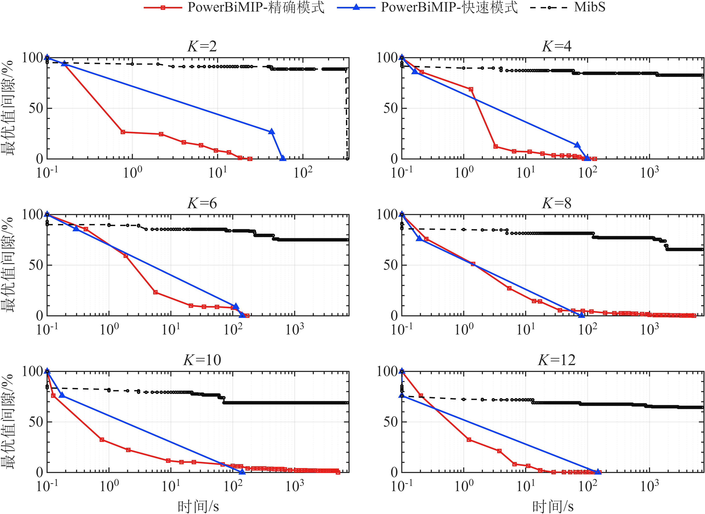
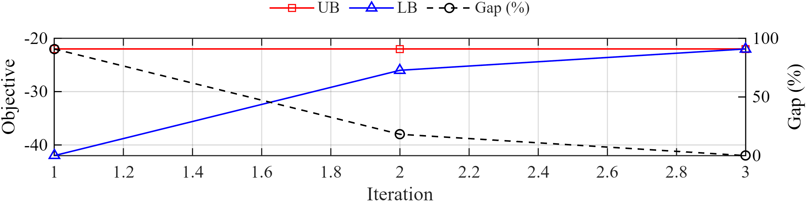
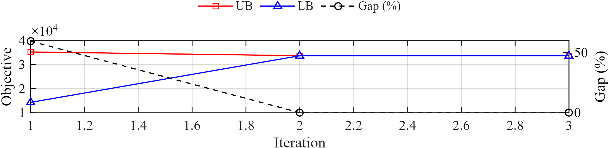

<div align="center">
  <picture>
    <source media="(prefers-color-scheme: dark)" srcset="docs/source/_static/PowerBiMIP_logo-dark.svg">
    <source media="(prefers-color-scheme: light)" srcset="docs/source/_static/PowerBiMIP_logo.svg">
    
  </picture>
</div>

<h1 align="center">PowerBiMIP：面向电力与能源系统的双层混合整数规划求解器</h1>

<p align="center">
  <a href="README.md" lang="en">English</a> | <strong>简体中文</strong>
  &nbsp;·&nbsp;
  <a href="https://docs.powerbimip.com">官方文档</a>
  &nbsp;·&nbsp;
  <a href="https://docs.powerbimip.com/en/latest/case_library.html">算例库</a>
  &nbsp;·&nbsp;
  <a href="https://doi.org/10.13334/j.0258-8013.pcsee.261230">论文</a>
</p>

<p align="center">
  <a href="https://docs.powerbimip.com"></a>
  <a href="matlab/VERSION"></a>
  <a href="#安装"></a>
  <a href="LICENSE"></a>
  <a href="https://doi.org/10.13334/j.0258-8013.pcsee.261230"></a>
</p>

**PowerBiMIP** 是基于 MATLAB 与 YALMIP 构建的优化建模与求解工具箱，面向线性双层混合整数规划（BiMIP）以及具有线性规划补偿阶段的两阶段鲁棒优化（TRO-LP）。其双层求解器支持在上下层同时引入连续、二元与整数决策变量，涵盖乐观与悲观两类双层建模视角，并配套电力与能源系统典型基准算例。

> [!NOTE]
> **Python 与 Pyomo 支持（开发中）：** 当前发布的 PowerBiMIP v0.1.5 运行于 MATLAB 环境；支持 Pyomo 建模的 Python 版本正在开发中。

---

## 概览与核心功能

- **上下层混合整数变量建模：** 支持在上下层问题中同时声明连续变量（`sdpvar`）、二元变量（`binvar`）与一般整数变量（`intvar`）；目标函数与约束条件须为线性表达式。
- **乐观与悲观双层视角：** 支持求解含或不含上层耦合约束的乐观双层模型（含耦合约束时自动完成等价重构），以及不含上层耦合约束的悲观双层模型（基于正则化重构与求解后下层最优性检验）。当前悲观模式仅支持无上层耦合约束的模型与精确求解方法。
- **精确分解与快速罚函数算法：** 提供基于重构与分解（R&D）框架的 KKT 主问题（`exact_KKT`）、强对偶主问题（`exact_strong_duality`）与二元攻击 C&CG 割平面方法，并提供基于 L1 罚函数交替方向法（L1-PADM）的快速模式（`quick`），适用于大规模乐观双层与两阶段鲁棒算例。
- **两阶段鲁棒优化与标准格式读写：** 提供基于列与约束生成算法（C&CG）的两阶段鲁棒求解接口 `solve_TRO`（当前支持线性规划补偿问题），并支持读写 MibS 标准 `.mps`/`.aux` 模型文件（`mpsaux2yalmip`、`exportBiMIPToMibS`）。

### 与现有工具箱的功能对比

<table>
  <thead>
    <tr>
      <th rowspan="2" scope="col" align="left">工具箱</th>
      <th rowspan="2" scope="col" align="center">编程平台</th>
      <th colspan="3" scope="colgroup" align="center">模型支持</th>
    </tr>
    <tr>
      <th scope="col" align="center">下层<br>整数变量</th>
      <th scope="col" align="center">乐观双层 (OBL)</th>
      <th scope="col" align="center">悲观双层 (PBL)</th>
    </tr>
  </thead>
  <tbody>
    <tr>
      <td>YALMIP</td>
      <td align="center">MATLAB</td>
      <td align="center"></td>
      <td align="center"><strong>✓</strong></td>
      <td align="center"></td>
    </tr>
    <tr>
      <td>Pyomo/PAO</td>
      <td align="center">Python</td>
      <td align="center"></td>
      <td align="center"><strong>✓</strong></td>
      <td align="center"></td>
    </tr>
    <tr>
      <td>BilevelJuMP</td>
      <td align="center">Julia</td>
      <td align="center"></td>
      <td align="center"><strong>✓</strong></td>
      <td align="center"></td>
    </tr>
    <tr>
      <td>GAMS/EMP</td>
      <td align="center">GAMS</td>
      <td align="center"></td>
      <td align="center"><strong>✓</strong></td>
      <td align="center"></td>
    </tr>
    <tr>
      <td>MibS</td>
      <td align="center">C++</td>
      <td align="center"><strong>✓</strong></td>
      <td align="center"><strong>✓</strong><sup>1</sup></td>
      <td align="center"></td>
    </tr>
    <tr>
      <td><strong>PowerBiMIP</strong></td>
      <td align="center"><strong>MATLAB（Python<sup>2</sup>）</strong></td>
      <td align="center"><strong>✓</strong></td>
      <td align="center"><strong>✓</strong></td>
      <td align="center"><strong>✓</strong></td>
    </tr>
  </tbody>
</table>

<sup>1</sup> MibS 目前仅支持连接变量（connecting variables）全为整数变量的情形。<br>
<sup>2</sup> 支持 Pyomo 建模的 Python 版本正在开发中；表中的勾选标记对应当前 MATLAB 版本。

### IEEE RTS-96 算例与 MibS 的性能对比

<div align="center">
  <a href="docs/source/_static/figures/powerbimip-mibs-time-to-gap.png">
    
  </a>
</div>

**图：** IEEE 单区域 RTS-96 输电线路攻击脆弱性分析算例在攻击预算 $K = 2, 4, 6, 8, 10, 12$ 下的最优值间隙（%，纵轴）随求解时间（秒，对数刻度横轴）的变化曲线。红色方块为 PowerBiMIP 精确模式，蓝色三角为 PowerBiMIP 快速模式，黑色虚线为 MibS。实验配置与间隙定义详见[论文](https://doi.org/10.13334/j.0258-8013.pcsee.261230)。

---

## 安装

### 前置条件

1. **MATLAB：** R2019b 或更新版本。
2. **YALMIP：** 请从 [YALMIP GitHub 仓库](https://github.com/yalmip/YALMIP)安装较新版本。若使用 COPT，须按下方说明核对二次目标接口修复。
3. **MILP 求解器：** 至少安装一个 YALMIP 支持的混合整数线性规划求解器：Gurobi、CPLEX、COPT 或 MOSEK。

#### 中国学术用户的求解器选择

根据 [Gurobi 官方通知](https://support.gurobi.com/hc/en-us/articles/33982552193937-As-a-student-at-a-university-in-China-how-do-I-request-a-Free-Academic-License)，Gurobi 已停止在中国内地、香港和澳门提供免费学术许可（商业许可政策另行适用）。建议受影响的高校与科研机构用户选用[杉数求解器 COPT](https://www.shanshu.ai/copt)。

#### 重要提醒：使用 COPT 前请更新 YALMIP

部分旧版 YALMIP 的 [`solvers/yalmip2copt.m`](https://github.com/yalmip/YALMIP/blob/develop/solvers/yalmip2copt.m) 存在接口缺陷：当二次目标矩阵 `Q` 非零但至少包含一列全零元素时（例如部分变量仅出现在线性目标项中，或锥约束转换引入了辅助变量），接口可能**静默丢弃整个二次目标项，同时仍报告求解成功**。纯线性 MILP 模型不受此判断分支影响。

请将 YALMIP 更新至包含上游 `develop` 分支修复的版本：该修复在二次目标赋值与锥辅助变量维度扩展两处判断中，将 `any(interfacedata.Q)` 替换为标量判断 `nnz(interfacedata.Q)`。仅升级 COPT 本体无法修复该问题。

更新后请重启 MATLAB，并运行以下命令确认搜索路径前端未被旧版 YALMIP 覆盖：

```matlab
which yalmip2copt -all
```

### 安装步骤

1. **克隆仓库：** 使用 Git 或 [GitHub Desktop](https://desktop.github.com/) 获取源码：
   ```bash
   git clone https://github.com/GreatTM/PowerBiMIP.git
   ```
2. **添加 MATLAB 搜索路径：** 打开 MATLAB，切换至仓库下的 `matlab/` 目录并运行 `install`：
   ```matlab
   cd PowerBiMIP/matlab
   install
   ```
   `install.m` 会将 `config/`、`examples/` 与 `src/` 加入 MATLAB 路径，自动清理旧版目录结构残留的路径项并保存路径配置。
3. **验证安装：** 在 `matlab/` 目录下运行双层算例测试脚本（脚本默认调用 `'gurobi'`，若使用其他求解器可将 `'solver'` 改为 `'cplex'`、`'copt'` 或 `'mosek'`）：
   ```matlab
   run('examples/BiMIP_benchmarks/BiMIP_toy_example1.m');
   ```
   配置正常时，求解器将在 3 次迭代内收敛，并输出 `Objective value: -22.0000`、`Best bound: -22.0000` 与 `Gap: 0.00%`。

### 版本更新

在仓库根目录执行 `git pull`（或在 GitHub Desktop 中依次点击 **Fetch origin** 与 **Pull origin**）。若更新涉及文件夹迁移或重命名，请在 `matlab/` 目录下重新运行一次 `install` 并重启 MATLAB。

---

## 快速入门

完整的建模规范及 `BiMIPsettings`、`TROsettings` 参数列表请参阅[在线快速入门文档](https://docs.powerbimip.com/en/latest/getting_started.html)。

### 示例 1：双层混合整数规划（`solve_BiMIP`）

以下算例见 [`matlab/examples/BiMIP_benchmarks/BiMIP_toy_example1.m`](matlab/examples/BiMIP_benchmarks/BiMIP_toy_example1.m)（改编自 Moore & Bard, 1990；Zeng & An, 2014）。上层决策者选择非负整数 $x \in \mathbb{Z}_+$，其中四条上层约束含有下层整数变量 $z$：

$$
\begin{aligned}
\min_{x \in \mathbb{Z}_+} \quad & -x - 10 z \\
\text{s.t.} \quad & -25 x + 20 z \le 30, \quad x + 2 z \le 10, \\
& 2 x - z \le 15, \quad 2 x + 10 z \ge 15.
\end{aligned}
$$

对于给定的 $x$，下层决策者选择整数变量 $z$ 与松弛变量 $y$：

$$
\begin{aligned}
\min_{y \in \mathbb{R}_+^4,\, z \in \mathbb{Z}_+} \quad & z + 1000 \sum_{k=1}^{4} y_k \\
\text{s.t.} \quad & -25 x + 20 z \le 30 + y_1, \quad x + 2 z \le 10 + y_2, \\
& 2 x - z \le 15 + y_3, \quad 2 x + 10 z \ge 15 - y_4.
\end{aligned}
$$

```matlab
clear; close all; clc;
yalmip('clear');

% 1. 定义上下层变量
model.var_upper.x = intvar(1, 1, 'full');
model.var_lower.z = intvar(1, 1, 'full');
model.var_lower.y = sdpvar(4, 1, 'full');

% 2. 上层约束与目标函数（默认最小化；最大化问题请对目标函数取反）
model.cons_upper = (model.var_upper.x >= 0) + ...
    (-25 * model.var_upper.x + 20 * model.var_lower.z <= 30) + ...
    (model.var_upper.x + 2 * model.var_lower.z <= 10) + ...
    (2 * model.var_upper.x - model.var_lower.z <= 15) + ...
    (2 * model.var_upper.x + 10 * model.var_lower.z >= 15);
model.obj_upper = -model.var_upper.x - 10 * model.var_lower.z;

% 3. 下层约束与目标函数
model.cons_lower = ...
    (-25 * model.var_upper.x + 20 * model.var_lower.z <= 30 + model.var_lower.y(1)) + ...
    (model.var_upper.x + 2 * model.var_lower.z <= 10 + model.var_lower.y(2)) + ...
    (2 * model.var_upper.x - model.var_lower.z <= 15 + model.var_lower.y(3)) + ...
    (2 * model.var_upper.x + 10 * model.var_lower.z >= 15 - model.var_lower.y(4)) + ...
    (model.var_lower.z >= 0) + (model.var_lower.y >= 0);
model.obj_lower = model.var_lower.z + 1e3 * sum(model.var_lower.y, 'all');

% 4. 配置参数并求解
ops = BiMIPsettings( ...
    'perspective', 'optimistic', ...
    'method', 'exact_KKT', ...
    'solver', 'gurobi', ...
    'verbose', 2, ...
    'max_iterations', 10, ...
    'optimal_gap', 1e-4, ...
    'plot.verbose', 1);

[Solution, BiMIP_record] = solve_BiMIP(model, ops);
```

PowerBiMIP 自动完成四条含下层整数变量的上层耦合约束重构（默认惩罚系数 `kappa = 50`），并在 3 次迭代后收敛至最优解 $x = 2$、$z = 2$，`Solution.obj_upper = -22`。

<details>
<summary>查看求解日志与收敛曲线</summary>

```text
Welcome to PowerBiMIP v0.1.5 | © 2026 Yemin Wu, Southeast University
Open-source, efficient tools for power and energy system bilevel mixed-integer programming.
GitHub: https://github.com/GreatTM/PowerBiMIP
Docs:   https://docs.powerbimip.com
Bilevel optimization interface
--------------------------------------------------------------------------
Starting disciplined bilevel programming process...
Original model type: OBL-CC-2
Initial model has coupled constraints. Starting reformulation...
  Applying Transformation: [Optimistic + Coupled] -> [Optimistic + Uncoupled]
Disciplined bilevel programming process completed.
Final Model type: OBL
Problem Statistics:
  Upper-Level Constraints: 1 (1 ineq, 0 eq), 1 non-zeros
  Lower-Level Constraints: 17 (17 ineq, 0 eq), 33 non-zeros
  Variables (Total): 8 continuous, 2 integer (0 binary)
--------------------------------------------------------------------------
Solving with optimistic perspective...

-----------------------------------------------------------------------------------------------
  Iter |       MP Obj     SP1 Obj     SP2 Obj |          LB          UB         Gap |  Time(s)
-----------------------------------------------------------------------------------------------
     1 |     -42.0000      2.0000    -22.0000 |      -42.00      -22.00      90.91% |      0.4
     2 |     -26.0000      1.0000    -16.0000 |      -26.00      -22.00      18.18% |      0.6
     3 |     -22.0000      2.0000    -22.0000 |      -22.00      -22.00       0.00% |      0.8

Convergence criteria met (gap = 0.00% <= 0.01%).
-----------------------------------------------------------------------------------------------
Solution Summary:
  Objective value: -22.0000
  Best bound:      -22.0000
  Gap:             0.00%
  Iterations:      3
  Time elapsed:    0.78 seconds
-----------------------------------------------------------------------------------------------
```

<div align="center">
  
</div>

</details>

### 示例 2：两阶段鲁棒优化（`solve_TRO`）

以下算例见 [`matlab/examples/BiMIP_benchmarks/TRO_LP_toy_example1.m`](matlab/examples/BiMIP_benchmarks/TRO_LP_toy_example1.m)（三设施鲁棒选址-运输问题，引自 Zeng & Zhao, 2013）：

$$
\begin{aligned}
\min_{y \in \lbrace 0,1 \rbrace^3,\, z \in \mathbb{R}_+^3} \quad & f^{\top} y + c^{\top} z + \max_{g \in \mathcal{G}} \min_{x \ge 0} \sum_{i=1}^{3} \sum_{j=1}^{3} T_{ij} x_{ij} \\
\text{s.t.} \quad & z_i \le 800 y_i \quad (i = 1, 2, 3), \qquad \sum_{i=1}^{3} z_i \ge 772,
\end{aligned}
$$

其中第二阶段运输量 $x_{ij} \ge 0$ 满足产能上限 $\sum_j x_{ij} \le z_i$ 与最坏需求约束 $\sum_i x_{ij} \ge \bar{d}_j + 40 g_j$，不确定集为预算多面体 $\mathcal{G} = \lbrace g \in [0, 1]^3 : g_1 + g_2 + g_3 \le 1.8,\; g_1 + g_2 \le 1.2 \rbrace$。

```matlab
clear; close all; clc;
yalmip('clear');

f = [400; 414; 326];
c = [18; 25; 20];
T = [22, 33, 24; 33, 23, 30; 20, 25, 27];
d_nominal = [206; 274; 220];
n_facilities = 3; n_demands = 3; capacity_limit = 800;

% 1. 定义两阶段决策变量与不确定变量
model.var_1st.y     = binvar(n_facilities, 1, 'full');
model.var_1st.z     = sdpvar(n_facilities, 1, 'full');
model.var_uncertain = sdpvar(n_demands, 1, 'full');
model.var_2nd.x     = sdpvar(n_facilities, n_demands, 'full');

% 2. 第一阶段、第二阶段与不确定集约束
model.cons_1st = (model.var_1st.z >= 0) + (sum(model.var_1st.z) >= 772);
for i = 1:n_facilities
    model.cons_1st = model.cons_1st + (model.var_1st.z(i) <= capacity_limit * model.var_1st.y(i));
end

model.cons_2nd = (model.var_2nd.x(:) >= 0);
for i = 1:n_facilities
    model.cons_2nd = model.cons_2nd + (sum(model.var_2nd.x(i, :)) <= model.var_1st.z(i));
end
for j = 1:n_demands
    model.cons_2nd = model.cons_2nd + (sum(model.var_2nd.x(:, j)) >= d_nominal(j) + 40 * model.var_uncertain(j));
end

model.cons_uncertainty = (0 <= model.var_uncertain <= 1) + ...
    (sum(model.var_uncertain) <= 1.8) + ...
    (model.var_uncertain(1) + model.var_uncertain(2) <= 1.2);

% 3. 两阶段目标函数与 C&CG 求解
model.obj_1st = f' * model.var_1st.y + c' * model.var_1st.z;
model.obj_2nd = sum(sum(T .* model.var_2nd.x));

ops = TROsettings('mode', 'exact_KKT', 'solver', 'gurobi', 'verbose', 2, 'plot.verbose', 1);
[Solution, Robust_record] = solve_TRO(model, ops);
```

C&CG 算法在 3 次迭代内收敛：两阶段最坏场景总成本为 `Robust_record.UB(end) = 33680.0000`（`Solution.obj_1st = 15655.6000` 仅表示第一阶段选址与建设投资成本），最优方案开启设施 1 与设施 3，建设容量分别为 255.20 与 516.80。

<details>
<summary>查看求解日志与收敛曲线</summary>

```text
Welcome to PowerBiMIP v0.1.5 | © 2026 Yemin Wu, Southeast University
Open-source, efficient tools for power and energy system bilevel mixed-integer programming.
GitHub: https://github.com/GreatTM/PowerBiMIP
Docs:   https://docs.powerbimip.com
Two-stage robust optimization interface
-----------------------------------------------------------------------------------------------
  Iter |       MP Obj      SP Obj |          LB          UB      Gap(%) |  Time(s)
-----------------------------------------------------------------------------------------------
     1 |   14296.0000  20942.0000 |  14296.0000  35238.0000    59.4302% |    0.190
     2 |   33680.0000  18034.0000 |  33680.0000  33696.0000     0.0475% |    0.391
     3 |   33680.0000  18024.4000 |  33680.0000  33680.0000     0.0000% |    0.577

Converged! Relative gap (0.0000%) <= tolerance (0.0100%).
-----------------------------------------------------------------------------------------------
Final Results:
  Lower Bound (LB): 33680.000000
  Upper Bound (UB): 33680.000000
  Final Gap:       0.0000%
  Total Iterations: 3
  Total Runtime:    0.705 seconds
-----------------------------------------------------------------------------------------------
First-Stage Objective: 15655.6000
  Facility 1: OPEN (Capacity: 255.20)
  Facility 2: CLOSED
  Facility 3: OPEN (Capacity: 516.80)
```

<div align="center">
  
</div>

</details>

---

## 电力与能源系统算例库

所有算例脚本与数据集均位于 [`matlab/examples/`](matlab/examples) 目录下，完整的数学模型说明与参考文献见在线[算例库文档](https://docs.powerbimip.com/en/latest/case_library.html)。

| 算例 | 求解接口 | 系统与规模 | 入口脚本 |
| :--- | :--- | :--- | :--- |
| 输电网脆弱性分析 | `solve_BiMIP` | IEEE 单区域 RTS-96（24 节点，38 + 38 个二元变量） | [`main_Vulnerability_Analysis.m`](matlab/examples/Vulnerability_Analysis/main_Vulnerability_Analysis.m) |
| 面向决策预测与机组组合 | `solve_BiMIP` | IEEE 118 节点系统（22,680 个下层二元变量） | [`main_SPO.m`](matlab/examples/SPO/main_SPO.m) |
| 综合能源自适应鲁棒调度 | `solve_TRO` | 33 节点电-热-建筑耦合系统（24 小时 C&CG） | [`TRO_IES_example.m`](matlab/examples/TRO-IES/TRO_IES_example.m) |
| 标准双层与鲁棒基准集 | `solve_BiMIP`、`solve_TRO` | 2 个入门算例 + 9 个 `.mps`/`.aux` 算例 | [`BiMIP_benchmarks/`](matlab/examples/BiMIP_benchmarks) |

---

## 引用方式

若您在公开发表的研究工作中使用了 PowerBiMIP，请引用以下论文（[DOI: 10.13334/j.0258-8013.pcsee.261230](https://doi.org/10.13334/j.0258-8013.pcsee.261230)，[引用详情](https://docs.powerbimip.com/en/latest/citation.html)）：

- **中文：**
  > [1] 吴晔敏,陆帅,顾伟,等.PowerBiMIP：面向电力能源系统优化的规范化双层混合整数规划建模与求解器[J/OL].中国电机工程学报,1-18[2026-09-21].DOI:10.13334/j.0258-8013.pcsee.261230.

- **英文：**
  > [1] Y. Wu, S. Lu, W. Gu, B. Zeng, Y. Xu and M. Chen, "PowerBiMIP: A Standardized Modeling Framework and Solver for Bilevel Mixed-Integer Programming in Power and Energy Systems," *Proceedings of the CSEE*, 2026, pp. 1-18, doi: 10.13334/j.0258-8013.pcsee.261230.

<details>
<summary>BibTeX</summary>

```bibtex
@article{wu2026powerbimip,
  author  = {Wu, Yemin and Lu, Shuai and Gu, Wei and Zeng, Bo and Xu, Yijun and Chen, Mingji},
  title   = {{PowerBiMIP}: A Standardized Modeling Framework and Solver for Bilevel Mixed-Integer Programming in Power and Energy Systems},
  journal = {Proceedings of the CSEE},
  year    = {2026},
  pages   = {1--18},
  doi     = {10.13334/j.0258-8013.pcsee.261230}
}
```

</details>

## 致谢

PowerBiMIP 由东南大学吴晔敏在**陆帅副教授**（[@Shuai-Lu](https://github.com/Shuai-Lu)）和**顾伟教授**指导下开发。

工具箱核心分解算法基于匹兹堡大学**曾波教授**在双层优化领域的研究工作，快速求解模式（`quick` / Fast-R&D）的开发亦得到曾波教授的悉心指导。感谢**俞睿智博士**（[@rzyu45](https://github.com/rzyu45)）在文档网站建设中提供的技术指导。

## 许可证

Copyright © 2026 Yemin Wu (`yemin.wu@seu.edu.cn`), Southeast University.

PowerBiMIP 仅授权用于**学术与非商业研究**。任何商业用途，或将本软件及其衍生作品作为商业产品或商业服务的一部分进行再分发，均须事先获得著作权人的书面许可。完整条款请参阅 [LICENSE](LICENSE)。

## 交流与联系

- **在线文档：** [docs.powerbimip.com](https://docs.powerbimip.com)
- **问题反馈与功能建议：** [GitHub Issues](https://github.com/GreatTM/PowerBiMIP/issues)
- **电子邮箱：** [yemin.wu@seu.edu.cn](mailto:yemin.wu@seu.edu.cn)
- **微信学术交流群：**

<p>
  
</p>
