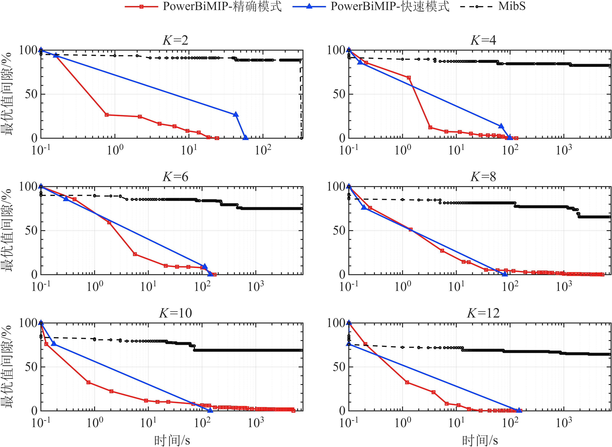

(powerbimip)=
(bilevel-mixed-integer-programming-for-power-and-energy-systems)=
# A dedicated solver for bilevel <span class="pb-title-term">mixed-integer</span> programming, <span class="pb-hero-accent">tailored to power and energy systems.</span>

<p class="pb-hero-meta"><code class="pb-release">v0.1.5</code> <span>MATLAB R2019b+ · YALMIP · Gurobi, CPLEX, COPT, MOSEK</span></p>

<div class="pb-hero-copy">
  <p class="pb-hero-lede">PowerBiMIP is a dedicated MATLAB solver built on YALMIP for linear bilevel mixed-integer programming (BiMIP) and two-stage robust optimization with linear recourse (TRO-LP). Its bilevel engine solves optimistic and pessimistic formulations with continuous, binary, and integer variables at both levels, paired with benchmark models for power grids, unit commitment, and integrated energy dispatch.</p>
  <div class="pb-actions">
    <a class="pb-button pb-button-primary" href="installation.html">Install PowerBiMIP</a>
    <a class="pb-button" href="getting_started.html">Read the tutorial</a>
    <a class="pb-quiet-link" href="https://github.com/GreatTM/PowerBiMIP">GitHub</a>
  </div>
</div>

<section class="pb-workbench" id="formulate-and-solve-in-yalmip-syntax" aria-label="Solver workbench">
  <span id="start-heading"></span>
  <div class="pb-workbench-toolbar">
    <div class="pb-tab-list" role="tablist" focusgroup="tablist nomemory" aria-label="Solver interface examples">
      <button type="button" id="pb-tab-bimip" role="tab" aria-selected="true" focusgroupstart>solve_BiMIP.m</button>
      <button type="button" id="pb-tab-tro" role="tab" aria-selected="false">solve_TRO.m</button>
      <button type="button" id="pb-tab-math" role="tab" aria-selected="false">Formulation</button>
    </div>
    <button class="pb-copy-button pb-workbench-copy" type="button" aria-label="Copy solve_BiMIP.m" hidden>Copy</button>
    <span class="pb-copy-status" role="status" aria-live="polite"></span>
  </div>
  <div class="pb-workbench-panels">
    <div id="pb-panel-bimip" role="tabpanel" aria-labelledby="pb-tab-bimip">
      <div class="pb-workbench-panel">

```matlab
yalmip('clear');

model.var_upper.x = intvar(1, 1, 'full');   % Upper-level integer variable
model.var_lower.z = intvar(1, 1, 'full');   % Lower-level integer variable
model.var_lower.y = sdpvar(4, 1, 'full');   % Lower-level continuous variables

A = [-25, 20; 1, 2; 2, -1; -2, -10];
b = [30; 10; 15; -15];
u = [model.var_upper.x; model.var_lower.z];

model.cons_upper = (model.var_upper.x >= 0) + (A * u <= b);
model.cons_lower = (A * u <= b + model.var_lower.y) + ...
                   (model.var_lower.z >= 0) + (model.var_lower.y >= 0);
model.obj_upper  = -model.var_upper.x - 10 * model.var_lower.z;
model.obj_lower  = model.var_lower.z + 1e3 * sum(model.var_lower.y, 'all');

ops = BiMIPsettings('perspective', 'optimistic', ...
                    'method', 'exact_KKT', 'solver', 'gurobi');
[Solution, BiMIP_record] = solve_BiMIP(model, ops);
```

<p class="pb-telemetry"><span aria-hidden="true">✓</span> Converged in 3 R&amp;D iterations · Gap 0.00% · x = 2, z = 2 · obj = −22.00</p>
      </div>
    </div>
    <div id="pb-panel-tro" role="tabpanel" aria-labelledby="pb-tab-tro" hidden="until-found">
      <div class="pb-workbench-panel">

```matlab
yalmip('clear');
f = [400; 414; 326]; c = [18; 25; 20]; d_nominal = [206; 274; 220];
T = [22, 33, 24; 33, 23, 30; 20, 25, 27];

model.var_1st.y     = binvar(3, 1, 'full');     % Facility open/close (binary)
model.var_1st.z     = sdpvar(3, 1, 'full');     % Facility capacity
model.var_uncertain = sdpvar(3, 1, 'full');     % Budgeted demand uncertainty
model.var_2nd.x     = sdpvar(3, 3, 'full');     % Recourse shipments (LP)

model.cons_1st = (model.var_1st.z >= 0) + (sum(model.var_1st.z) >= 772) + ...
    (model.var_1st.z <= 800 * model.var_1st.y);
model.cons_2nd = (model.var_2nd.x(:) >= 0) + ...
    (sum(model.var_2nd.x, 2) <= model.var_1st.z) + ...
    (sum(model.var_2nd.x, 1)' >= d_nominal + 40 * model.var_uncertain);
model.cons_uncertainty = (model.var_uncertain >= 0) + (model.var_uncertain <= 1) + ...
    (sum(model.var_uncertain) <= 1.8) + (sum(model.var_uncertain(1:2)) <= 1.2);
model.obj_1st  = f' * model.var_1st.y + c' * model.var_1st.z;
model.obj_2nd  = sum(sum(T .* model.var_2nd.x));

ops = TROsettings('mode', 'exact_KKT', 'solver', 'gurobi');
[Solution, Robust_record] = solve_TRO(model, ops);
```

<p class="pb-telemetry"><span aria-hidden="true">✓</span> Converged in 3 C&amp;CG iterations · Gap 0.00% · Worst-case UB = 33,680.00</p>
      </div>
    </div>
    <div id="pb-panel-math" role="tabpanel" aria-labelledby="pb-tab-math" hidden="until-found">
      <div class="pb-workbench-panel pb-formulation">

$$
\begin{aligned}
\min_{x_u, z_u, x_l, z_l} \;& c_u^{\top} x_u + d_u^{\top} z_u + e_u^{\top} x_l + f_u^{\top} z_l \\
\text{s.t.} \;& (x_u, z_u, x_l, z_l) \in \Omega_u, \quad (x_u, z_u) \in \mathbb{R}^{n_u} \times \mathbb{Z}^{p_u}, \\
& (x_l, z_l) \in \arg\min_{\tilde{x}_l, \tilde{z}_l} \bigl\{ e_l^{\top} \tilde{x}_l + f_l^{\top} \tilde{z}_l : (\tilde{x}_l, \tilde{z}_l) \in \Omega_l(x_u, z_u) \cap (\mathbb{R}^{n_l} \times \mathbb{Z}^{p_l}) \bigr\}
\end{aligned}
$$

Upper-level feasible set $\Omega_u$ and parameterized lower-level feasible set $\Omega_l(x_u, z_u)$ are polyhedra defined by linear equalities and inequalities. PowerBiMIP classifies each model into standard optimistic (`OBL`), coupled optimistic (`OBL-CC`, reformulated automatically), or uncoupled pessimistic (`PBL`) form before invoking exact R&D or `quick` L1-penalty decomposition.

<p class="pb-telemetry">Linear objectives &amp; polyhedral sets · Automatic OBL / OBL-CC / PBL classification · <a href="getting_started.html">Getting started</a></p>
      </div>
    </div>
  </div>
</section>

<dl class="pb-hero-specs">
  <div><dt>Both levels</dt><dd>Continuous, binary &amp; integer</dd></div>
  <div><dt>OBL &amp; PBL</dt><dd>Optimistic &amp; pessimistic</dd></div>
  <div><dt>Exact &amp; Quick</dt><dd>KKT / dual R&amp;D &amp; L1-PADM</dd></div>
  <div><dt>Robust &amp; MibS</dt><dd><code>solve_TRO</code> C&amp;CG &amp; <code>.mps</code>/<code>.aux</code></dd></div>
</dl>

<section class="pb-home-section pb-proof" aria-labelledby="benchmark-and-ecosystem">
  <h2 id="benchmark-and-ecosystem">Benchmark and solver comparison</h2>
  <div class="pb-proof-grid">
    <section class="pb-showcase pb-comparison" aria-labelledby="comparison-with-existing-toolboxes">
      <h3 id="comparison-with-existing-toolboxes">Comparison with existing bilevel toolboxes</h3>
      <p class="pb-table-hint">Scroll to see all columns.</p>

| Toolbox | Platform | Lower-level integers | Optimistic | Pessimistic |
| :--- | :--- | :---: | :---: | :---: |
| YALMIP | MATLAB | | **✓** | |
| Pyomo/PAO | Python | | **✓** | |
| BilevelJuMP | Julia | | **✓** | |
| GAMS/EMP | GAMS | | **✓** | |
| MibS | C++ | **✓** | **✓**<sup>1</sup> | |
| **PowerBiMIP** | **MATLAB (Python<sup>2</sup>)** | **✓** | **✓** | **✓** |

<p><sup>1</sup> MibS currently supports cases with pure integer connecting variables.<br>
<sup>2</sup> The Python version with Pyomo modeling support is under development. Checkmarks describe the current MATLAB version.</p>
    </section>
    <section class="pb-showcase" aria-labelledby="benchmark-against-mibs">
      <h3 id="benchmark-against-mibs">Benchmark against MibS on IEEE RTS-96</h3>
      <figure class="pb-benchmark-figure">
        <div class="pb-figure-mat">
          
        </div>
        <ul class="pb-benchmark-legend" aria-label="Benchmark series" role="list">
          <li><span class="pb-legend-exact" aria-hidden="true">■</span> Exact R&amp;D</li>
          <li><span class="pb-legend-quick" aria-hidden="true">▲</span> Quick L1-PADM</li>
          <li><span class="pb-legend-mibs" aria-hidden="true">●</span> MibS</li>
        </ul>
        <figcaption>

Optimality gap (<span lang="zh-CN">最优值间隙</span>, %) versus solve time on a logarithmic scale (<span lang="zh-CN">时间</span>, s) on the one-area IEEE RTS-96 line-interdiction benchmark for attack budgets $K = 2, 4, 6, 8, 10, 12$. Red squares mark PowerBiMIP exact mode (<span lang="zh-CN">PowerBiMIP-精确模式</span>), blue triangles mark PowerBiMIP quick mode (<span lang="zh-CN">PowerBiMIP-快速模式</span>), and the black dashed line marks MibS ([paper](https://doi.org/10.13334/j.0258-8013.pcsee.261230)).

</figcaption>
</figure>
<a href="case_library.html#transmission-grid-vulnerability-analysis">Read the benchmark setup</a>
</section>
</div>
</section>

<section class="pb-home-section" id="supported-models-and-methods" aria-labelledby="capabilities-heading">
  <h2 id="capabilities-heading">Supported models and methods</h2>
  <div class="pb-capability-grid">
    <article class="pb-spec-card">
      <p class="pb-card-index">01 / Variable domains</p>
      <h3>Mixed-integer variables at both levels</h3>
      <p>Declare continuous (<code>sdpvar</code>), binary (<code>binvar</code>), and integer (<code>intvar</code>) variables in both upper and lower problems. Objectives and constraints must be linear.</p>
    </article>
    <article class="pb-spec-card">
      <p class="pb-card-index">02 / Perspectives</p>
      <h3>Optimistic and pessimistic perspectives</h3>
      <p>Solve optimistic bilevel models, including coupled upper-level constraints, and pessimistic bilevel models. Pessimistic mode requires uncoupled upper-level constraints and exact methods.</p>
    </article>
    <article class="pb-spec-card">
      <p class="pb-card-index">03 / Decomposition</p>
      <h3>Exact R&amp;D and the quick method</h3>
      <p>Choose reformulation and decomposition (R&amp;D) with KKT or strong-duality master problems, or the L1-penalty alternating direction method (<code>quick</code>) for optimistic BiMIP and TRO-LP models.</p>
    </article>
    <article class="pb-spec-card">
      <p class="pb-card-index">04 / Robust &amp; I/O</p>
      <h3>Two-stage robust optimization and MPS/AUX I/O</h3>
      <p>Use <code>solve_TRO</code> for two-stage robust optimization with linear programming recourse via column-and-constraint generation (C&amp;CG). Import or export MibS <code>.mps</code>/<code>.aux</code> files.</p>
    </article>
  </div>
</section>

<section class="pb-home-section" id="power-and-energy-system-cases" aria-labelledby="case-studies-heading">
  <h2 id="case-studies-heading">Power and energy system cases</h2>
  <div class="pb-case-grid">
    <article class="pb-case-card">
      <header class="pb-case-metadata"><p class="pb-case-interface"><code>solve_BiMIP</code> · BiMIP interdiction</p></header>
      <h3><a class="card-link" href="case_library.html#transmission-grid-vulnerability-analysis">Transmission grid vulnerability analysis</a></h3>
      <p>An attacker disconnects <var>K</var> transmission lines while the system operator minimizes load shedding through DC redispatch and corrective line switching.</p>
      <footer>One-area IEEE RTS-96 (24-bus, 38-branch) · 38 + 38 binaries</footer>
    </article>
    <article class="pb-case-card">
      <header class="pb-case-metadata"><p class="pb-case-interface"><code>solve_BiMIP</code> · Closed-loop SPO</p></header>
      <h3><a class="card-link" href="case_library.html#decision-focused-forecasting-and-unit-commitment">Decision-focused forecasting and unit commitment</a></h3>
      <p>Trains renewable forecast parameters jointly with day-ahead unit commitment and real-time redispatch to reduce operating cost.</p>
      <footer>IEEE 118-bus · 22,680 lower-level binaries</footer>
    </article>
    <article class="pb-case-card">
      <header class="pb-case-metadata"><p class="pb-case-interface"><code>solve_TRO</code> · Two-stage C&amp;CG</p></header>
      <h3><a class="card-link" href="case_library.html#adaptive-robust-dispatch-of-integrated-energy-systems">Adaptive robust dispatch of integrated energy systems</a></h3>
      <p>Schedules distribution power flow, district heating, storage, and building thermal inertia against four polyhedral uncertainty sets.</p>
      <footer>33-bus electricity-heat network · 24-hour dispatch</footer>
    </article>
  </div>
  <div class="pb-benchmarks-strip">
    <p>Eleven standard BiMIP, robust, and <code>.mps</code>/<code>.aux</code> benchmark scripts are also included in <code>matlab/examples/BiMIP_benchmarks/</code>.</p>
    <a href="case_library.html#standard-bimip-and-tro-benchmarks">Case library</a>
  </div>
</section>

<div class="pb-home-section pb-footer-band">
  <section class="pb-footer-panel" id="citation-and-license" aria-labelledby="paper-heading">
    <h2 id="paper-heading">Citation and license</h2>
    <div class="pb-home-citation" id="pb-home-citation-en">[1] Y. Wu, S. Lu, W. Gu, B. Zeng, Y. Xu and M. Chen, "PowerBiMIP: A Standardized Modeling Framework and Solver for Bilevel Mixed-Integer Programming in Power and Energy Systems," Proceedings of the CSEE, 2026, pp. 1-18, doi: <a href="https://doi.org/10.13334/j.0258-8013.pcsee.261230">10.13334/j.0258-8013.pcsee.261230</a>.</div>
    <div class="pb-citation-actions">
      <button class="pb-copy-citation" type="button" data-copy-target="pb-home-citation-en" hidden>Copy English</button>
      <span class="pb-copy-status" role="status" aria-live="polite"></span>
    </div>
    <div class="pb-home-citation" id="pb-home-citation-zh" lang="zh-CN">[1] 吴晔敏,陆帅,顾伟,等.PowerBiMIP：面向电力能源系统优化的规范化双层混合整数规划建模与求解器[J/OL].中国电机工程学报,1-18[2026-09-21].DOI:10.13334/j.0258-8013.pcsee.261230.</div>
    <div class="pb-citation-actions">
      <button class="pb-copy-citation" type="button" data-copy-target="pb-home-citation-zh" hidden>Copy Chinese</button>
      <span class="pb-copy-status" role="status" aria-live="polite"></span>
    </div>
    <a href="citation.html">BibTeX &amp; license</a>
  </section>
  <section class="pb-footer-panel pb-community" id="contact" aria-labelledby="community-heading">
    <h2 id="community-heading">Python and community</h2>
    <p>A Python version of PowerBiMIP with Pyomo modeling support is in development.</p>
    <p class="pb-contact-links">
      <a href="https://github.com/GreatTM/PowerBiMIP/issues">GitHub Issues</a>
      <a href="mailto:yemin.wu@seu.edu.cn">yemin.wu@seu.edu.cn</a>
    </p>
    <p class="pb-home-license">PowerBiMIP is licensed for academic and non-commercial research only (<a href="https://github.com/GreatTM/PowerBiMIP/blob/main/LICENSE">LICENSE</a>).</p>
  </section>
</div>

```{toctree}
:hidden:
:maxdepth: 2

Installation <installation>
Getting started <getting_started>
Case library <case_library>
Citation and license <citation>
```
